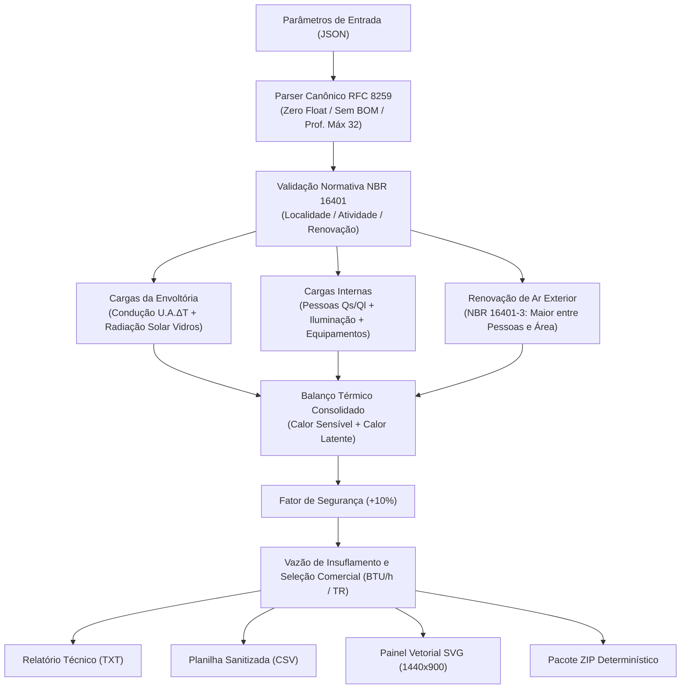

# Dimensionamento de Climatização e Ar-Condicionado - ABNT NBR 16401:2008

[](https://github.com/martinlofranodeoliveira/dimensionamento-climatizacao-nbr16401/actions/workflows/ci.yml)
[](https://www.python.org/)
[](https://opensource.org/licenses/MIT)
[](https://www.abnt.org.br/)
[-emerald.svg)](https://docs.python.org/3/library/fractions.html)

Motor computacional em Python puro para cálculo de **carga térmica**, avaliação de **renovação de ar exterior** e dimensionamento de sistemas de **climatização e ar-condicionado** (AVAC/HVAC) em conformidade com as três partes da norma brasileira **ABNT NBR 16401:2008**:
- **Parte 1**: Projeto das instalações e parâmetros climáticos de projeto;
- **Parte 2**: Parâmetros de conforto térmico de verão e inverno;
- **Parte 3**: Qualidade do ar interior e taxas mínimas de renovação de ar exterior.

Desenvolvido segundo as diretrizes de rigor matemático da **Lofrano Tecnologia**, o motor opera com **aritmética estritamente racional exata (`fractions.Fraction` e inteiros)**, garantindo total imunidade a imprecisões de arredondamento inerentes ao padrão IEEE-754 (`float`).

---

## Painel Executivo do Sistema


---

## Recursos e Destaques

- **Balanço Térmico Integral**: Cálculo individualizado de todas as parcelas térmicas: condução por paredes, divisórias e coberturas; radiação solar incidente em superfícies envidraçadas; calor sensível e latente emitido por ocupantes; iluminação artificial; equipamentos eletroeletrônicos; e infiltração/renovação de ar exterior.
- **Aritmética Racional Exata (Zero Float)**: Todas as taxas térmicas em $W$, $kcal/h$, $BTU/h$, vazões volumétricas em $m^3/h$ e capacidades em Toneladas de Refrigeração ($TR$) operam exclusivamente com frações e inteiros.
- **Condições Climáticas Brasileiras (NBR 16401-1)**: Dados de projeto para as principais capitais (Temperatura de Bulbo Seco externa $T_{\text{ext}}$ e umidade absoluta $w_{\text{ext}}$).
- **Conforto Térmico e Atividade Metabólica (NBR 16401-2)**: Dissipação metabólica sensível e latente segundo o tipo de atividade física (escritórios sentados, comércio moderado, restaurantes, salas de aula, academias e auditórios).
- **Qualidade do Ar Interior (NBR 16401-3)**: Vazão mínima de ar exterior calculada simultaneamente por taxa por pessoa ($m^3/(h \cdot \text{pessoa})$) e taxa por área útil ($m^3/(h \cdot m^2)$), adotando-se o maior valor normativo.
- **Vazão de Insuflamento e FCS**: Determinação do Fator de Calor Sensível ($FCS = Q_s / Q_T$) e da vazão de ar insuflado necessária para manter o diferencial de temperatura de insuflamento ($\Delta T = 10^\circ\text{C}$).
- **Seleção Comercial Padronizada**: Enquadramento automático na capacidade comercial de equipamentos em BTU/h ($9.000$ a $600.000\text{ BTU/h}$) e TR ($0{,}75$ a $50\text{ TR}$).
- **Exportação Multiformato e Pacote ZIP Seguro**: Relatórios técnicos em texto puro, planilhas CSV com proteção ativa contra injeção de fórmulas e arquivos ZIP determinísticos com carimbo fixo (`2026-01-01 00:00:00`) criados sob `os.O_EXCL`.

---

## Arquitetura do Sistema



---

## Formulações Matemáticas Normativas

### 1. Transmissão Térmica pela Envoltória

A transferência de calor por condução em regime permanente através das paredes, coberturas e divisórias:

$$Q_{\text{condução}} = U \times A \times \Delta T \quad [\text{kcal/h}]$$

A carga radiante solar direta transmitida através de superfícies envidraçadas:

$$Q_{\text{solar}} = A \times I_{\text{fachada}} \times FS \times 0{,}86 \quad [\text{kcal/h}]$$

onde $FS$ é o Fator Solar do vidro (com ou sem persianas/películas) e $I_{\text{fachada}}$ é a radiação solar incidente de projeto em $W/m^2$.

### 2. Cargas Internas de Ocupação e Equipamentos

$$Q_{\text{pessoas,s}} = N \times q_{\text{s,w}} \times 0{,}86 \quad [\text{kcal/h}]$$
$$Q_{\text{pessoas,l}} = N \times q_{\text{l,w}} \times 0{,}86 \quad [\text{kcal/h}]$$
$$Q_{\text{iluminação}} = P_{\text{ilum}} \times F_{\text{uso}} \times 0{,}86 \quad [\text{kcal/h}]$$
$$Q_{\text{equipamentos}} = P_{\text{equip}} \times F_{\text{simultaneidade}} \times 0{,}86 \quad [\text{kcal/h}]$$

### 3. Renovação de Ar Exterior (NBR 16401-3)

A vazão mínima de ar exterior é o máximo entre a exigência por ocupante e por metro quadrado de piso:

$$V_{\text{ar}} = \max\left(N \times V_{\text{pessoa}}, \; A_{\text{piso}} \times V_{\text{área}}\right) \quad [\text{m}^3/\text{h}]$$

As parcelas térmicas introduzidas pelo ar externo:

$$Q_{\text{ar,s}} = \rho \cdot c_p \cdot V_{\text{ar}} \cdot (T_{\text{ext}} - T_{\text{int}}) = 0{,}288 \times V_{\text{ar}} \times \Delta T \quad [\text{kcal/h}]$$
$$Q_{\text{ar,l}} = 0{,}70 \times V_{\text{ar}} \times (w_{\text{ext}} - w_{\text{int}}) \quad [\text{kcal/h}]$$

### 4. Carga Térmica Total e Vazão de Insuflamento

Com a aplicação da margem de segurança normativa (+10%):

$$Q_T = (Q_{\text{sensível,subtotal}} + Q_{\text{latente,subtotal}}) \times \left(1 + \frac{\text{margem}}{100}\right) \quad [\text{kcal/h}]$$
$$Q_{\text{BTU/h}} = Q_T \times \frac{15873}{4000} \approx Q_T \times 3{,}96825 \quad [\text{BTU/h}]$$
$$Q_{\text{TR}} = \frac{Q_T}{3024} \quad [\text{TR}]$$

Vazão volumétrica de ar insuflado para diferencial de insuflamento $\Delta T_{\text{ins}} = 10^\circ\text{C}$:

$$V_{\text{ins}} = \frac{Q_{\text{sensível,total}}}{0{,}288 \times 10} \quad [\text{m}^3/\text{h}]$$

---

## Instalação e Requisitos

O pacote requer **Python 3.11 ou superior** e não utiliza nenhuma dependência externa de terceiros em produção.

```bash
# Clonar repositório
git clone https://github.com/martinlofranodeoliveira/dimensionamento-climatizacao-nbr16401.git
cd dimensionamento-climatizacao-nbr16401

# Instalação editável (opcional)
pip install -e .
```

---

## Utilização via Linha de Comando (CLI)

### 1. Consultar Catálogo Normativo
```bash
climatizacao-nbr16401 catalogo
```

### 2. Gerar Arquivo de Exemplo
```bash
climatizacao-nbr16401 gerar-exemplo --tipo escritorio --saida projeto_escritorio.json
```

### 3. Executar Dimensionamento e Exportar Resultados
```bash
climatizacao-nbr16401 calcular projeto_escritorio.json \
  --saida-txt relatorio.txt \
  --saida-json resultado.json \
  --saida-csv envoltoria.csv \
  --saida-svg painel.svg \
  --pacote-zip pacote_completo.zip
```

---

## Utilização via Biblioteca Python

```python
from fractions import Fraction
from climatizacao_nbr16401 import (
    CargaEquipamentos,
    CargaIluminacao,
    CargaOcupantes,
    ElementoEnvoltoria,
    EspacoClimatizado,
    calcular_climatizacao_nbr16401,
)

# Definir espaço climatizado
espaco = EspacoClimatizado(
    projeto="Sala de Treinamento",
    localidade="sao_paulo",
    tipo_renovacao="sala_aula",
    area_piso_m2=Fraction(80, 1),
    pe_direito_m=Fraction(3, 1),
    ocupantes=CargaOcupantes(quantidade_pessoas=30, atividade="sala_aula"),
    iluminacao=CargaIluminacao(potencia_total_w=Fraction(800, 1)),
    equipamentos=CargaEquipamentos(potencia_total_w=Fraction(1500, 1)),
    envoltoria=(
        ElementoEnvoltoria(
            nome="Janela Fachada Norte",
            tipo_material="vidro_simples_incolor_4mm",
            area_m2=Fraction(15, 1),
            orientacao="norte",
            fator_solar_vidro="vidro_incolor_com_persiana_interna",
        ),
        ElementoEnvoltoria(
            nome="Parede Alvenaria",
            tipo_material="alvenaria_tijolo_furado_reboco",
            area_m2=Fraction(40, 1),
            orientacao="norte",
        ),
    ),
)

resultado = calcular_climatizacao_nbr16401(espaco)

print(f"Carga Térmica Total: {resultado.carga_termica_total_btu_h} BTU/h")
print(f"Capacidade Comercial Recomendada: {resultado.capacidade_comercial_btu_h} BTU/h ({resultado.capacidade_comercial_tr} TR)")
print(f"Vazão de Renovação de Ar: {resultado.vazao_ar_renovacao_m3_h} m³/h")
```

---

## Execução dos Testes e Auditoria Independente

```bash
# Executar suíte de testes unitários nativa (unittest)
python3 -m unittest discover -s tests -p "test_*.py" -v

# Executar auditor independente em SQLite em memória (sem imports de produção)
python3 tools/verify_independent.py

# Verificar integridade dos pacotes de distribuição
python3 -m build
python3 scripts/check_distribution.py
```

---

## Licença

Distribuído sob a licença **MIT**. Consulte o arquivo [LICENSE](LICENSE) para mais detalhes.

**Lofrano Tecnologia** • Engenharia de Software e Climatização 2026.
